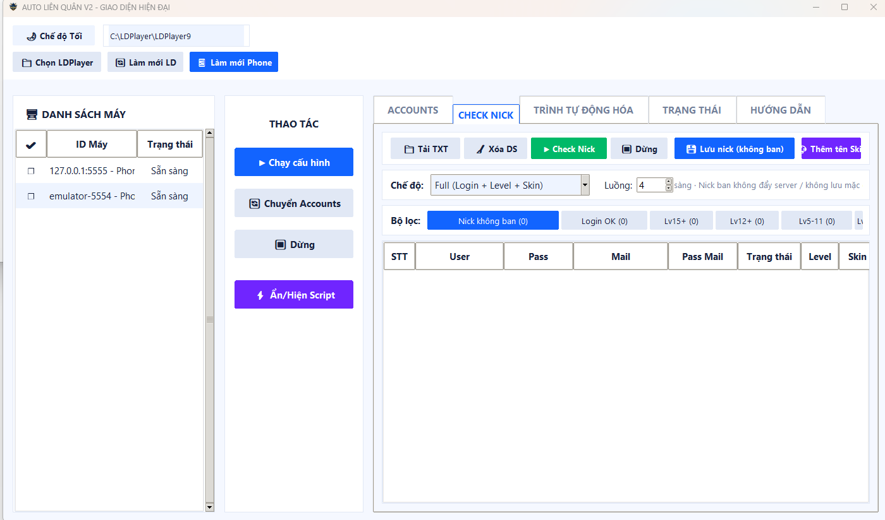

  
  
  # 👑 AUTO APQT AUTO LOGIN LIÊN QUÂN V2
  **Công Cụ Tự Động Đăng Nhập & Kiểm Tra Tài Khoản Hàng Loạt**
  
  
  
  
  

---

**AUTO APQT AUTO LOGIN LIÊN QUÂN V2** là bộ công cụ Auto Script chuyên dụng giúp giải phóng hoàn toàn đôi tay của bạn trong việc quản lý tài khoản game. Được tối ưu hóa để tự động đăng nhập và điều khiển mượt mà vô số **giả lập khác nhau** cùng lúc, đồng thời tương thích hoàn hảo với **Hệ thống Điện thoại thật (Phone Farm)**. 

Dự án được chia sẻ **100% MIỄN PHÍ**. Quản trị tập trung, an toàn tuyệt đối, tích hợp sẵn các kịch bản Bypass thông minh.

## 🚀 Tính Năng Nổi Bật

- 🎮 **Auto Login Liên Quân:** Tự động hóa hoàn toàn quy trình đăng nhập hàng loạt tài khoản trên đa thiết bị, hỗ trợ thao tác nhanh gọn, không lo chéo luồng.
- ✅ **Hỗ Trợ Check Nick (TÍNH NĂNG MỚI):** Kịch bản tự động kiểm tra và trích xuất thông tin tài khoản (số Tướng, Trang phục, Rank, Vàng, Quân huy, độ tín nhiệm...) nhanh chóng và lưu trữ log gọn gàng.
- 📱 **Điều Khiển Đa Thiết Bị:** Quản lý đồng thời hàng loạt giả lập và hệ thống điện thoại thật cực kỳ nhẹ nhàng, tối ưu tài nguyên phần cứng.
- 👁️ **Mắt Thần Nhận Diện (AI):** Công nghệ OpenCV quét màn hình với chế độ *Check Ảnh 60s*. Xử lý triệt để tình trạng lag mạng: không thấy ảnh = chờ hoặc dừng, không bao giờ click bậy hay kẹt script.
- ⌨️ **Tùy Biến Kịch Bản (Macro):** Tự do thiết lập các bước: Click Tọa Độ, Auto điền văn bản, Lặp vòng, và Chạy nối tiếp Script.
- ⚙️ **Kiểm Soát Ứng Dụng Sâu:** Tương tác trực tiếp vào hệ thống Android: Tự động mở App, Xóa Data App để làm sạch cache (Clear data trước khi log nick mới), Cài file APK hàng loạt.
- ⚡ **Auto Thiết Lập ADB:** Phần mềm thông minh tự nhận diện môi trường và tải ADB nếu cần, đảm bảo thiết bị thực và giả lập luôn sẵn sàng.

## 📸 Hình Ảnh Minh Họa

Dưới đây là giao diện thiết lập kịch bản đăng nhập, check nick và quản lý thiết bị (giả lập/phone thật) để vận hành hệ thống:

## 🛠️ Các Bước Sử Dụng

1. **Tải Công Cụ (Free):** Tải toàn bộ mã nguồn của dự án này về máy tính và giải nén.
2. **Cấu Hình & Kết Nối:** Bật chế độ ADB trên thiết bị và quét kết nối trên phần mềm để nhận diện hệ thống Phone thật hoặc các loại giả lập.
3. **Chuẩn Bị Dữ Liệu:** Nhập danh sách tài khoản (Tài khoản|Mật khẩu) vào file cấu hình.
4. **Khởi Động:** Mở ứng dụng, cài đặt danh sách thiết bị, chọn kịch bản (Auto Login / Check Nick) và nhấn **CHẠY AUTO** để hệ thống tự động làm việc!

> ⚠️ **LƯU Ý KẾT NỐI ADB QUAN TRỌNG:**  
> Bạn **BẮT BUỘC** phải vào phần *Cài đặt* trên Giả lập hoặc Điện thoại thật -> Bật **"Chế độ gỡ lỗi USB" (ADB Debugging)** để phần mềm có thể nhận diện thiết bị và tương tác điều khiển.

## 🔮 Định Hướng Tương Lai (Roadmap)

Chúng tôi đang không ngừng nâng cấp hệ thống trở thành cỗ máy cày cuốc công nghiệp mạnh mẽ nhất:

- 🟣 **[ 1 ] Tối Ưu Check Thông Tin:** Cải thiện tốc độ nhận diện ảnh để trích xuất thông tin nick Liên Quân siêu tốc.
- 🔵 **[ 2 ] Mắt Thần AI Giải Captcha:** Tích hợp dịch vụ Anti-Captcha. Tool tự nhìn hình, tự giải đố để vượt qua các rào cản đăng nhập khó.
- 🟢 **[ 3 ] Tương Thích Thiết Bị Rộng Mở:** Mở rộng thuật toán ADB để nhận diện ổn định mọi dòng máy điện thoại Android, tối ưu hóa băng thông cáp kết nối cho các dàn Phone Farm khủng.

---

  <h2>☕ Ủng Hộ (Donate) Dự Án</h2>
  
Dự án này được phát triển và chia sẻ <strong>hoàn toàn miễn phí</strong>. Nếu bạn thấy tool hữu ích, giúp tiết kiệm thời gian check nick và quản lý tài khoản, bạn có thể ủng hộ để tiếp thêm động lực cho dev duy trì và phát triển thêm nhiều tính năng mới! ❤️

  
  <table>
    <tr>
      <td align="center">🏦 <b>Ngân hàng</b></td>
      <td align="center">💳 <b>Số tài khoản</b></td>
      <td align="center">📝 <b>Nội dung chuyển khoản</b></td>
    </tr>
    <tr>
      <td align="center">KienLongBank</td>
      <td align="center"><h3><code>24243939</code></h3></td>
      <td align="center"><code>Donate APQT</code></td>
    </tr>
  </table>

---

  <h3>📞 Liên Hệ & Hỗ Trợ</h3>
  
Phát triển bởi <b>Trường Phan</b>

  

    <a href="https://apqt.top">🌐 Xem Website: APQT.TOP</a> &nbsp; | &nbsp; 
    <a href="https://t.me/APQTTOP">✈️ Liên hệ Telegram: @APQTTOP</a>
  

